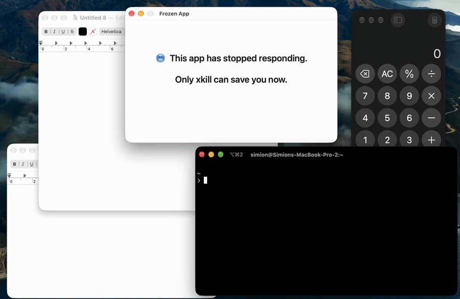

# xkill for macOS

The macOS equivalent of Linux's `xkill`: run it, click a window, and that app is gone.



Run `xkill` and the cursor turns into an ✕ on every screen and Desktop.
The window under the pointer is highlighted in red with its app's name, so you see what you're about to kill.
Click it and the app is killed on the spot (`SIGKILL`, the same as `kill -9`), and a notification says what died.
Esc or right-click cancels.

```sh
brew install simion/tap/xkill
```

Updates come with `brew upgrade`.

> **Warning:** this is the hard kill. The app gets no chance to save, so unsaved work is lost.

## Differences from X11 `xkill`

Same workflow, adapted to how macOS works:

- **It kills the whole app.** X11 `xkill` closes one client's X connection; macOS has no equivalent, so this sends `SIGKILL` to the process that owns the window. All of that app's windows go with it.
- **No flags.** `-id`, `-button`, `-frame` and `-all` aren't implemented. Click-to-kill is the whole tool.
- **Extras:** the red highlight before you click, and a notification after.

## Notes

- Only regular app windows can be picked, so a stray click can't kill the Dock, the menu bar or WindowServer.
- No special permissions needed.
- The notification is posted through `osascript`, so macOS lists it under **Script Editor**.
  If you don't see it, turn on System Settings → Notifications → Script Editor.
- If you have XQuartz, it ships its own X11 `xkill` in `/opt/X11/bin`; whichever comes first in your `PATH` wins.

## Build from source

```sh
swiftc -O xkill.swift -o xkill
./xkill --selftest   # prints "ok"
```

## Releasing

Push a `vX.Y.Z` tag. The release workflow publishes a GitHub release and bumps the formula in
[simion/homebrew-tap](https://github.com/simion/homebrew-tap), so `brew upgrade` picks it up.

## License

MIT
